# Literature Review: Evolution of AI-Assisted Research Systems & Scholarly Intelligence Platforms

**Generated by**: Research Nexus AI Engine (Module 8: Literature Synthesis & Authoring)  
**Target Domain**: Scientific NLP, Scholarly Knowledge Graphs, RAG & GraphRAG for Academic Discovery  

---

## 1. Executive Narrative Review

The rapid increase in scientific publications has made research more challenging than ever. Every year, millions of papers are published across journals, conferences, and preprint repositories, making it difficult for researchers to find relevant studies, understand different methodologies, compare existing work, identify research gaps, and combine information from multiple sources. Although digital libraries and academic search engines have simplified access to research papers, they mainly focus on document retrieval rather than understanding the deep domain knowledge contained within them. As a result, researchers still spend a significant amount of time manually reviewing and analyzing literature. This has driven the critical need for intelligent AI-based systems capable of understanding, organizing, retrieving, and generating meaningful insights from scientific publications.

### 1.1 Foundation of Scientific NLP
A key requirement for such systems is the ability to understand scientific language accurately. Traditional Natural Language Processing (NLP) models trained on general-purpose text often struggle with domain-specific terminology, mathematical notation, and the dense context found in research papers. To address this challenge, **SciBERT** [1] introduced a transformer-based language model specifically pretrained on scientific literature from biomedical and computer science domains. Unlike general language models, SciBERT learns scientific vocabulary and contextual relationships directly from research papers, leading to significant improvements in named entity recognition (NER), relation extraction, sentence classification, and dependency parsing. This work laid the foundation for scientific NLP and demonstrated that domain-specific language models are essential for accurately extracting knowledge from scholarly documents.

### 1.2 Structuring Scholarly Knowledge
While SciBERT [1] significantly improved the understanding of individual research papers, it did not capture the multi-faceted relationships between multiple publications. Scientific knowledge is spread across thousands of papers, where connections between authors, methodologies, datasets, algorithms, and research findings are equally important. This limitation led researchers to explore **Scholarly Knowledge Graphs (SKGs)**, which represent scientific information as interconnected entities instead of isolated documents.

The review *Scholarly Knowledge Graphs Through Structuring Scholarly Communication* [4] highlighted the importance of knowledge graphs in transforming traditional document-based research into structured knowledge representation. It demonstrated how entities such as papers, authors, citations, datasets, methods, and research concepts can be linked to improve knowledge discovery. Similarly, *Mapping Scholarly Knowledge: A Systematic Review of Knowledge Graphs for Academic Papers* [5] examined existing scholarly knowledge graph techniques, identified current trends, and discussed the challenges involved in building and maintaining these graphs. Together, these studies established knowledge graphs as a promising solution for organizing scientific knowledge and enabling more intelligent exploration of research literature.

### 1.3 Automated Knowledge Graph Construction
Building on this idea, *Generate FAIR Literature Surveys with Scholarly Knowledge Graphs* [2] proposed using scholarly knowledge graphs to automate literature surveys. Instead of treating research papers as standalone PDF documents, the approach represented important research components such as methodologies, datasets, algorithms, evaluation metrics, and experimental findings as structured entities. This enabled automatic comparison of research contributions while following the FAIR principles (Findable, Accessible, Interoperable, and Reusable). The study demonstrated that literature surveys could evolve from static documents into dynamic, machine-readable knowledge resources.

Although this approach showed the benefits of structured knowledge representation, constructing knowledge graphs manually remained a labor-intensive task. To reduce this manual effort, *Creating a Scholarly Knowledge Graph from Survey Article Tables* [3] proposed an automated framework that extracts structured information directly from comparison tables in survey papers. The extracted entities and relationships are then integrated into the Open Research Knowledge Graph (ORKG), making scholarly knowledge searchable, reusable, and easier to analyze. This work represented an important step toward scalable and automated knowledge graph construction.

### 1.4 Intelligent Retrieval & Semantic Exploration
Once scientific knowledge is organized, researchers must be able to retrieve the most relevant information efficiently. Traditional keyword-based search often returns many irrelevant results because it cannot fully understand the intent behind a research query. To overcome this limitation, *A Novel Knowledge-Entity-Grounded Scholarly Retrieval Framework in Full-Text Academic Documents* [9] introduced an entity-aware semantic retrieval framework that combines scientific entity extraction with intelligent retrieval techniques. By understanding the meaning of a query rather than simply matching keywords, the framework significantly improved the relevance of retrieved research papers.

Further improving scientific search, *Introducing ORKG ASK: An AI-driven Scholarly Literature Search and Exploration System* [6] integrated scholarly knowledge graphs with AI-based search capabilities. Instead of manually searching through hundreds of papers, researchers could ask intelligent questions and explore scientific knowledge through structured queries. This marked a transition from conventional search engines to AI-assisted research exploration.

### 1.5 Synthesis & Graph-RAG Reasoning
Although semantic retrieval improved access to relevant literature, researchers still had to manually read, compare, and summarize the retrieved papers. This challenge led to the adoption of Retrieval-Augmented Generation (RAG), which combines large language models with external knowledge retrieval to generate accurate and evidence-based responses.

The systematic review *Retrieval-Augmented Generation (RAG) and Large Language Models for Enterprise Knowledge Management* [8] provided a comprehensive overview of modern RAG architectures and demonstrated how combining retrieval systems with large language models improves factual accuracy, scalability, and domain-specific reasoning. Extending these ideas specifically to scientific research, *SciRAG: Adaptive, Citation-Aware, and Outline-Guided Retrieval and Synthesis for Scientific Literature* [7] introduced a citation-aware RAG framework capable of retrieving relevant research papers, analyzing citation relationships, and generating structured scientific summaries supported by evidence. This represented a significant advancement toward AI systems capable of reasoning across multiple research papers instead of processing them individually.

More recent studies have explored combining vector databases with knowledge graphs to further improve retrieval quality. *From Vectors to Knowledge Graphs: A Comprehensive Analysis of Modern Retrieval-Augmented Generation Architectures* [10] examined the evolution of RAG systems toward hybrid GraphRAG architectures. The study showed that while vector databases are effective for similarity-based retrieval, knowledge graphs capture meaningful relationships between scientific entities. Integrating both approaches enables AI systems to retrieve relevant information while also understanding the connections between concepts, methodologies, datasets, and research outcomes, leading to more accurate and context-aware reasoning.

---

## 2. Evolution Roadmap of AI-Assisted Research Systems

```mermaid
flowchart TD
    A["Exponential Growth of Scientific Literature<br/>• Millions of papers published annually<br/>• Information overload & manual review bottleneck"] --> C1

    subgraph C1 ["Challenge 1: Understand Scientific Text"]
        P1["[1] SciBERT<br/>• Domain-specific pretrained language model<br/>• Scientific NER & contextual embeddings"]
    end
    
    C1 -- "Limitation: Papers remain isolated" --> C2

    subgraph C2 ["Challenge 2: Organize Scientific Knowledge"]
        P4["[4] SKG Review<br/>• Knowledge graphs<br/>• Research relationships"]
        P5["[5] Mapping Scholarly Knowledge<br/>• KG trends & techniques<br/>• State-of-the-art review"]
    end

    C2 -- "Limitation: Knowledge graphs require manual creation" --> C3

    subgraph C3 ["Challenge 3: Automate Knowledge Graph Construction"]
        P2["[2] FAIR Literature Surveys<br/>• FAIR knowledge<br/>• Structured comparison"]
        P3["[3] KG from Survey Tables<br/>• Automatic extraction<br/>• ORKG integration"]
    end

    C3 -- "Limitation: Knowledge exists but retrieval is weak" --> C4

    subgraph C4 ["Challenge 4: Intelligent Scientific Retrieval"]
        P6["[6] ORKG ASK<br/>• AI literature search<br/>• Knowledge exploration"]
        P9["[9] Entity-Grounded Retrieval<br/>• Semantic retrieval<br/>• Entity-aware search"]
    end

    C4 -- "Limitation: Retrieved papers must still be read manually" --> C5

    subgraph C5 ["Challenge 5: Multi-Paper Reasoning & Synthesis"]
        P8["[8] RAG Survey<br/>• Retrieval + LLM<br/>• Evidence grounding"]
        P7["[7] SciRAG<br/>• Citation-aware synthesis<br/>• Scientific summarization"]
    end

    C5 -- "Limitation: Vector retrieval misses explicit relationships" --> C6

    subgraph C6 ["Challenge 6: Hybrid Retrieval & Graph Reasoning"]
        P10["[10] Modern GraphRAG Architectures<br/>• Hybrid Vector + Knowledge Graph retrieval<br/>• Relationship-aware reasoning"]
    end

    C6 --> RN["Remaining Gaps Addressed by Research Nexus<br/>✓ Automated research gap detection<br/>✓ Cross-paper methodology matrix<br/>✓ Automatic graph & visualization generation<br/>✓ End-to-end AI-assisted paper writing"]
```

---

## 3. Systematic Literature Comparison Matrix

| Paper | Key Achievements | Research Gaps & Limitations | Relevance to Research Nexus |
| :--- | :--- | :--- | :--- |
| **[1] SciBERT: A Pretrained Language Model for Scientific Text (2019)** | • Pretrained BERT on biomedical & CS literature. • Significantly improved scientific NER, relation extraction, and parsing. • State-of-the-art contextual embeddings. | • Limited to individual document processing. • No cross-paper reasoning or comparison. • Lacks Knowledge Graph generation or RAG. | • Serves as the NLP embedding backbone for entity & metadata extraction. • Enables domain-specific semantic understanding. |
| **[2] Generate FAIR Literature Surveys with Scholarly KGs (2020)** | • Proposed FAIR literature survey generation. • Introduced SKGs for structured representation of research. • Enabled comparison of scientific contributions. | • Assumes structured knowledge already exists. • Requires heavy manual curation. • No automated LLM paper generation. | • Forms conceptual basis for Knowledge Graph module. • Inspires automated matrix & survey generation. |
| **[3] Creating SKG from Survey Article Tables (2020)** | • Automated knowledge extraction from comparison tables. • Converted survey tables into machine-readable KGs. • Integrated directly into ORKG. | • Restricted to survey article tables. • Does not analyze full unstructured text. • No conversational RAG or automated writing. | • Methodological foundation for table-to-graph extraction. • Supports scalable entity relation mapping. |
| **[4] Scholarly Knowledge Graphs: A Review** | • Categorized knowledge graph construction techniques. • Comprehensive analysis of applications & challenges. • Defined future research directions in SKGs. | • Survey paper only; no software implementation. • Limited discussion on LLM integration. • Does not propose complete research workflows. | • Provides theoretical foundation for designing the graph architecture. • Identifies best practices in knowledge modeling. |
| **[5] Mapping Scholarly Knowledge: Systematic Review (2026)** | • Reviewed over 100 scholarly knowledge graph studies. • Analyzed trends, methodologies, and graph applications. • Summarized state-of-the-art developments. | • Analytical overview rather than technical system. • Minimal exploration of hybrid GraphRAG. • No end-to-end user platform. | • Validates the necessity of integrating KGs with AI. • Identifies literature trends for project justification. |
| **[6] Introducing ORKG ASK: Literature Search System** | • Developed AI-powered scholarly search system. • Combined ORKG with intelligent question answering. • Improved exploration of research knowledge. | • Limited conversational & multi-turn reasoning. • Focuses mainly on search & exploration. • Lacks paper authoring & gap detection. | • Inspires semantic literature discovery module. • Demonstrates natural language queries over graphs. |
| **[7] SciRAG: Adaptive, Citation-Aware Retrieval & Synthesis** | • Introduced citation-aware RAG for scientific papers. • Improved multi-document synthesis. • Generated evidence-backed structured summaries. | • Focused primarily on literature synthesis. • Does not build explicit persistent Knowledge Graphs. • Lacks interactive visualization & writing suite. | • Core architectural baseline for RAG & synthesis engine. • Guides citation-aware evidence retrieval. |
| **[8] RAG & LLMs for Enterprise Knowledge Management (2024)** | • Comprehensive review of RAG architectures. • Analyzed retrieval pipelines & LLM integration. • Highlighted accuracy & factual grounding. | • Enterprise focus rather than academic research. • No scientific domain NLP or citation reasoning. • Lacks specialized scholarly entities. | • Provides enterprise RAG pipeline design guidelines. • Supports retrieval & indexing decisions. |
| **[9] Knowledge-Entity-Grounded Scholarly Retrieval Framework** | • Entity-grounded semantic retrieval framework. • Enhanced relevance of full-text academic search. • Combined NER with dense retrieval. | • Focused strictly on search & retrieval. • No multi-paper summarization or reasoning. • No automated paper generation or graph analytics. | • Strengthens entity-aware semantic search. • Complements Knowledge Graph vector indexing. |
| **[10] From Vectors to Knowledge Graphs: GraphRAG Architectures** | • Analyzed transition from vector RAG to GraphRAG. • Demonstrated superiority of graph-vector hybrid retrieval. • Detailed relationship-aware reasoning. | • Survey without direct software implementation. • Does not cover scientific paper authoring. • Lacks end-to-end platform integration. | • Blueprint for Research Nexus hybrid GraphRAG engine. • Enables context-aware multi-document reasoning. |

---

## 4. Identified Research Gaps & Research Nexus Rationale

Despite significant advancements across individual areas, current solutions suffer from fragmentation across the research lifecycle:

1. **Fragmented Capabilities**: Existing tools specialize in either NLP parsing ([1]), knowledge graph curation ([2,3,4,5]), semantic search ([6,9]), or RAG synthesis ([7,8,10]), but fail to integrate these capabilities into a single workflow.
2. **Lack of Automated Research Gap Detection**: Current RAG systems retrieve existing information but cannot systematically detect contradictions, open questions, or unexplored methodological combinations across papers.
3. **Absence of Publication-Ready AI Authoring**: No existing platform seamlessly connects literature discovery, matrix analysis, and gap detection directly to an AI-assisted manuscript authoring environment with citation formatting.

### The Research Nexus Ecosystem
To address these limitations, **Research Nexus** unifies scientific NLP, GraphRAG reasoning, automated literature matrix generation, research gap analysis, interactive visualization, and publication-ready manuscript authoring into a single production platform.

---

Simple text summary ends here.
